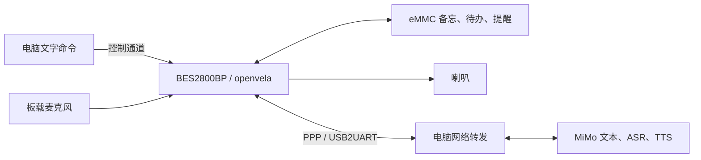

# 朝夕 · 无屏 AI 生活管家

朝夕是一台基于 **BES2800BP 和 openvela** 的桌面助手，把问答、随手记、待办和定时提醒放在同一块开发板上。它使用板载麦克风采集声音，通过 MiMo 处理语言，再用喇叭播报；备忘、待办和提醒保存在板上的持久存储中。

当前作品采用无屏设计，演示时由电脑经 USB2UART 提供网络。语言识别、模型调用、文件操作、提醒调度和语音播放都在 BES 上运行，电脑负责网络转发和操作入口。

## 三个核心功能

| 功能 | 可以做什么 | 示例 |
| --- | --- | --- |
| 问答 | 调用模型回答问题，通过文字或语音返回 | “用一句话解释 DMA” |
| 记事与待办 | 记录当天备忘；添加、查询和完成带固定编号的待办 | “记一下明天带学生证”；添加“交作业”后按编号完成 |
| 定时提醒 | 创建、查询、取消提醒；到期播报事项，网络不可用时使用本机提示音 | “三十秒后提醒我喝水” |

待办命令直接读写本地文件，添加和完成操作不需要模型。自然语言记事、待办和提醒使用 AI Agent 的工具流程，取得成功保存的结果后再确认完成。

## 硬件与运行架构

- **主控**：BES2800BP EVB，运行 openvela／NuttX 与 AI Agent。
- **输入**：板载 U19、U20 数字麦克风，以及电脑文字命令。
- **输出**：现有两线喇叭，沿用已调通的 LP／LN 接法。
- **存储**：eMMC 上的 `/emmc/zhaoxi`，保存备忘、待办、提醒及运行配置。
- **联网**：Windows 串口转发与 WSL PPP 网关，共用电脑当前的互联网连接。



## 启动作品

已烧入固件、部署业务资产并配置服务凭据的板子，可以直接按下面的流程运行。新板部署见 [构建与安装](docs/BES固件构建与验收.md)。

演示电脑需要 Windows、Python 3、`pyserial` 和 Ubuntu-22.04 WSL。WSL 中准备好 Python 3、`pppd`、`ip`、`iptables`、PPP／TUN 设备，并使用能够配置网络转发的 root 环境。电脑应已连接互联网。

在仓库根目录安装串口组件并检查环境：

```powershell
python -m pip install pyserial==3.5
python tools/pc_link/launch.py --check-only
```

1. 接好开发板供电和 **USB2UART** 数据线，关闭其他占用该串口的程序。
2. 双击 [仅共享网络.cmd](tools/pc_link/仅共享网络.cmd)，或执行下面的命令：

   ```powershell
   python tools/pc_link/launch.py --port COM3
   ```

3. 保留启动窗口，等它完成板端 UTC 授时并显示 `PPP_UPLINK_READY`。
4. 在另一个 PowerShell 窗口发送业务命令。结束时运行 `python tools/pc_link/launch.py --stop`，等待正常结束提示。

`COM3` 按设备管理器中实际串口修改。只有一个匹配的 FTDI 设备时，也可以省略 `--port`。供网期间由启动程序管理串口，文字操作统一通过下面的控制入口发送。

## 体验三个功能

**问答与备忘**：默认经喇叭回复，备忘还可以直接回读。

```powershell
python tools/pc_link/control.py --cmd ask 用一句话解释DMA
python tools/pc_link/control.py --cmd note 明天带学生证
python tools/pc_link/control.py --notes
```

**待办**：先添加并查看真实编号，再完成目标项。

```powershell
python tools/pc_link/control.py --cmd --text todo add 交作业
python tools/pc_link/control.py --tasks
python tools/pc_link/control.py --cmd --text todo done 2
```

将示例中的 `2` 换成查询到的编号。完成后再运行 `--tasks`，可以看到目标项变为 `[x]`，其他项继续保留。

**提醒**：下面创建一条 30 秒后的语音提醒。

```powershell
python tools/pc_link/control.py --cmd remind in 30 喝水
python tools/pc_link/control.py --reminders
```

要取消某条提醒，使用 `python tools/pc_link/control.py --cmd remind cancel a123b456`，把 `a123b456` 换成实际返回的八位编号。更多自然语言输入、数据格式和操作方式见 [核心功能使用说明](docs/无屏核心功能.md)。

## 开发状态

当前演示方式以**电脑供网、文字业务输入与语音播报**为主。连续语音交互和板载 Wi-Fi 独立联网仍在联调，自动监听默认关闭；需要现场体验时，由使用者主动选择 [开始自动语音](tools/pc_link/开始自动语音.cmd)。

最新 AP 构建为 `0c915c38…`，已完成编译和烧录，包含本地待办及记事／提醒的工具执行确认。当前镜像、安装方法和测试范围统一记录在 [构建与验收](docs/BES固件构建与验收.md)。

## 源码与文档

| 目录或文档 | 内容 |
| --- | --- |
| [app/zhaoxi](app/zhaoxi/README.md) | 产品命令、本地待办、提醒、BES 音频、MiMo 适配和电脑供网 |
| [assets/agent_deploy](assets/agent_deploy/README.md) | 人格配置、智能记事本与智能提醒 Skill、空白提醒模板 |
| [tools/pc_link](tools/pc_link/README_zh-cn.md) | Windows 一键启动、UTC 授时、网络转发与控制命令 |
| [patches](patches/README.md) | AI Agent、apps、BES 启动和 NuttX 的集成补丁与顺序 |
| [configs](configs/bes_headless.sources.json) | 固定源码版本、BSP 库校验值和构建配置 |
| [固件构建与验收](docs/BES固件构建与验收.md) | 构建依赖、AP 镜像、烧录、资产部署和测试入口 |
| [交付核对清单](docs/交付核对清单.md) | 演示电脑、实物外壳与比赛材料交接 |
| [legacy](legacy/README.md) | 原圆屏应用及历史扩展，保留供后续移植参考 |
