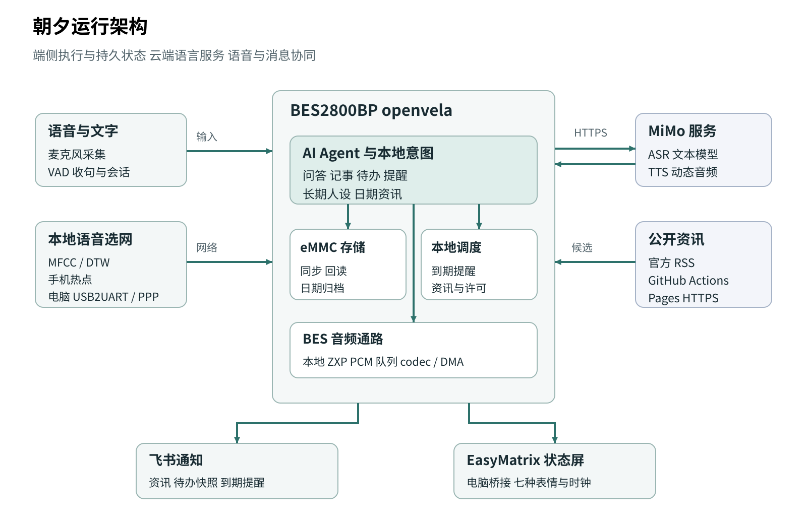

# 朝夕 主动式 AI 生活管家

**随口记下一件事，让朝夕在合适的时候提醒你。**

朝夕是一台基于 **BES2800BP、openvela 和 MiMo** 的桌面 AI 生活管家。它通过板载麦克风听取需求，把问答、备忘、待办与定时提醒连接起来；也会按照你的兴趣准备资讯，先询问，再播报，并把需要回看的内容发送到飞书。

放在学习、编程或电子制作的书桌上，你可以一边做事，一边交代下一件事。朝夕负责保存、执行和提醒，像素表情屏则用聆听、思考、播报等状态回应你。

[了解作品](docs/project_introduction.md) · [技术方案](docs/technical_report.md) · [与 9 月 20 日版本对比](docs/版本演进20260920至20261104.md) · [资料导航](docs/submission/README.md)

## 在书桌旁这样使用

| 想做的事 | 对朝夕说 | 朝夕的回应 |
| --- | --- | --- |
| 问一个问题 | “一加一等于几？”“用一句话解释 DMA。” | 调用 MiMo 组织回答，通过喇叭播报 |
| 随手记下事情 | “帮我记一下，明天带学生证。” | 保存到当天备忘，之后可以回读 |
| 管理待办 | “添加待办，交作业。”“完成待办编号三。” | 为事项分配固定编号，完成指定条目 |
| 约定提醒 | “三十秒后提醒我喝水。” | 创建本地任务，到期主动提醒 |
| 建立日常节奏 | “开启喝水提醒。” | 按设置的周期提醒，也可查询或关闭 |
| 听感兴趣的新闻 | “播放今天的新闻。”“播放昨天的新闻。” | 根据日期读取资讯，播报对应的中文内容 |
| 让它更懂你的兴趣 | “记住，我最近在学习嵌入式。” | 复述修改内容，获得确认后保存到长期人设 |

正常语音对话使用“你好，夕夕”唤醒。听到“你好”后说出需求，回答结束后可继续交流；一段时间没有说话，朝夕回到等待唤醒。使用规则见 [语音交互](docs/语音交互收尾.md)。

## 从开机到日常陪伴

**先选网络，再开始服务。** 开机后，朝夕用本地提示音询问“选择有线连接还是无线连接”。说“无线连接”，它连接已保存的手机热点；说“有线连接”，它与电脑待命程序建立 PPP 网络。两条选网口令由板端 MFCC 特征与 DTW 模板匹配处理，询问、成功和失败提示均来自本地音频。

**想到的事情留下来。** 备忘按北京时间分日归档，待办使用稳定编号，提醒保存到板载 eMMC。明确的记事、待办和相对时间提醒由本地 C 模块直接执行，写入、同步并回读后给出结果。

**主动服务也懂得先询问。** 朝夕按照长期人设筛选公开资讯，保存标题、来源、链接和中文摘要。早晨准备好内容后，先问“有新的资讯，需要播放吗？”，收到明确许可才播放。今天与昨天的内容各有自己的日期记录，随时可以重新听。

**离开书桌，也能回看。** 通过板端飞书通知，把资讯、待办清单和到期提醒发送到固定接收目标。语音用来即时交代，飞书用来保存和查阅，两种方式围绕同一组事项协同工作。

## 让这些体验落地的技术



| 技术设计 | 实现方式 | 对使用体验的帮助 |
| --- | --- | --- |
| 板端 Agent | openvela／NuttX 上运行 ai_agent，连接消息总线、工具、Skill、记忆和调度 | 语音需求可以接到实际的存储与任务执行 |
| 本地意图路由 | 明确事项直接进入记事、待办和提醒模块；自由问答进入 MiMo | 常用操作减少一次文本模型往返 |
| BES 音频通路 | 板载麦克风采集，云端 ASR／TTS，BES codec 与 HAL DMA 播放 | 输入、处理和播报在设备上连续衔接 |
| 分场景播放策略 | 无线使用 SSE 增量音频；PPP 先完整预取、校验，再连续播放 | 针对不同网络供音特点组织播放 |
| 持久存储 | eMMC 文件保存、同步、读回和原子替换 | 记录与配置可以跨会话继续使用 |
| 主动资讯 | GitHub Actions 定时采集官方 RSS，Pages 提供 HTTPS 候选，板端按人设整理与缓存 | 设备连接手机热点也能获取公开资讯 |
| 消息联动 | 飞书固定目标、事件编号、有界队列和服务回执 | 将桌面上的事项带到日常消息入口 |
| 状态表达 | EasyMatrix 七种颜文字与时钟页面，主机桥同步会话状态 | 聆听、思考、播报和任务结果更直观 |

在已记录的有线语音样本中，一段 **18.88 秒**的回答实际播放 **18.923 秒**，最大音频块间隔 **1 毫秒**。本地备忘与待办的实板操作样本约 **0.34～0.40 秒**，覆盖保存或修改及结果核对。测量方式见 [技术报告](docs/technical_report.md) 与 [语音连续播放](docs/对话语音连续播放.md)。

## 从圆屏原型到语音生活管家

9 月 20 日，朝夕已经建立了圆屏 UI、Skill、人格记忆与定时调度的产品骨架。现在，这些能力进一步融入语音输入、真实播报、持久事项、网络选择和飞书通知，形成可以连续使用的桌面任务流程。

| 9 月 20 日版本 | 当前版本 |
| --- | --- |
| 454×454 圆屏、触摸键盘与页面导航 | 麦克风与喇叭组成主要交互，配合可选像素表情屏 |
| 以 Skill、文件桥和 cron 组织事项 | 本地 C 业务与 Agent 工具协同，执行后保存并回读 |
| 配置网络后使用云端模型 | 开机本地选择热点或电脑 PPP，两种联网路径统一进入语音服务 |
| 围绕屏幕呈现简报与提醒 | 语音播报、按日期缓存的个性化资讯和飞书消息联动 |

完整变化与历史来源见 [版本演进](docs/版本演进20260920至20261104.md)。

## 运行与开发

已配置的设备接通电源后，按本地提示选择联网方式。选择有线时，电脑先启动 [待命入口](docs/开机语音选网.md#电脑待命)；选择无线时使用已保存的热点。完整操作见 [开机语音选网](docs/开机语音选网.md) 和 [核心功能用法](docs/无屏核心功能.md)。

开发电脑使用 Windows、Python 3、pyserial 与 Ubuntu-22.04 WSL。环境检查入口为：

```powershell
python -m pip install pyserial==3.5
python tools/pc_link/launch.py --check-only
```

| 阅读目的 | 入口 |
| --- | --- |
| 看产品与使用场景 | [作品介绍](docs/project_introduction.md) |
| 看算法、架构与实现 | [技术报告](docs/technical_report.md) |
| 看本次功能升级 | [9 月 20 日至 11 月 4 日版本演进](docs/版本演进20260920至20261104.md) |
| 查看作品资料与架构图 | [资料导航](docs/submission/README.md) |
| 使用设备和业务命令 | [核心功能](docs/无屏核心功能.md)、[电脑入口](tools/pc_link/README_zh-cn.md) |
| 构建与安装 | [BES 固件构建](docs/BES固件构建与验收.md)、[EasyMatrix](extension/EasyMatrix/README_zh-cn.md) |
| 查源码与工程记录 | [项目导览](docs/项目完整交接.md)、[开发记录](docs/development_logs/README.md) |

应用在 `app/zhaoxi`，SDK 集成在 `patches`，运行资产在 `assets`，验证入口在 `tests`。当前发布文件按各固件目录的 manifest 管理，便于对齐代码、镜像和部署资料。
