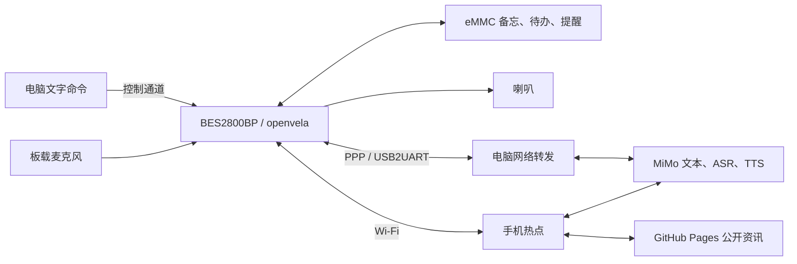

# 朝夕 · 无屏 AI 生活管家

朝夕是一台基于 **BES2800BP 和 openvela** 的桌面助手，把问答、随手记、待办和定时提醒放在同一块开发板上。它使用板载麦克风采集声音，通过 MiMo 处理语言，再用喇叭播报；备忘、待办和提醒保存在板上的持久存储中。

当前作品以语音交互为主，已配置设备开机先在本地询问“选择有线连接还是无线连接”，用个人训练的 MFCC/DTW 模板识别两条指令，**不是通用 ASR**，已有设备模板无需重录。选网询问、连接成功和连接失败使用三个本地 ZXP 提示音，选定前保持离线。无线连接已保存的手机热点，有线经电脑 PPP 供网；本轮无线与无 PC 时有线失败后改选无线已通过，提示音听感流畅，真实 PC 有线开机链路也已通过，Windows 登录任务真实启动与正常停止也已通过，重新登录触发仍待观察。BES 负责采集声音、发起 MiMo 请求、执行本地业务和播放音频，可选的 EasyMatrix 像素屏用于显示状态。

**第一次接手项目，请先读 [项目完整交接](docs/项目完整交接.md)**：从比赛背景、作品目标和硬件现状开始，说明软件结构、记忆与语音规则、现有成果、启动与开发方法，以及外壳和比赛材料待办。正式交付使用本仓库 `dev-ai-contest-2026` 分支，初期集成见 [PR #12](https://github.com/open-vela/contest2026_416_dianzinongmingong/pull/12)，唤醒、人设、晨报及独立联网更新见 [PR #13](https://github.com/open-vela/contest2026_416_dianzinongmingong/pull/13)；[11 月 2 日工作记录](docs/20261102夜间工作交接.md) 保留夜间修复与检查结果。

**2026-11-03 发布更新**：开机自动监听“你好，夕夕”及同音词，本地播报“你好”后等待提问；60 秒空闲返回唤醒检测。新增本地固定提示音、确认后语音修改长期人设，以及不依赖电脑的公开资讯服务。发布镜像与实板一致，见 [本地语音与独立资讯](docs/本地语音与独立资讯.md) 和 [构建与验收](docs/BES固件构建与验收.md)。

## 三个核心功能

| 功能 | 可以做什么 | 示例 |
| --- | --- | --- |
| 问答 | 调用模型回答问题，通过文字或语音返回 | “用一句话解释 DMA” |
| 记事与待办 | 记录当天备忘；添加、查询和完成带固定编号的待办 | “记一下明天带学生证”；添加“交作业”后按编号完成 |
| 定时提醒 | 创建、查询、取消提醒；到期播报事项，网络不可用时使用本机提示音 | “三十秒后提醒我喝水” |

明确的记事、待办和相对时间提醒优先在本地完成。例如“帮我记一下明天带学生证”“添加待办交作业”“三十秒后提醒我喝水”会直接保存并回读，省去文本模型等待；普通问答及更复杂的表达交给 AI Agent。支持的句式见 [本地中文指令](docs/本地中文指令.md)，备忘保存方式见 [本地记事](docs/本地记事.md)。

## 硬件与运行架构

- **主控**：BES2800BP EVB，运行 openvela／NuttX 与 AI Agent。
- **输入**：板载 U19、U20 数字麦克风，以及电脑文字命令。
- **输出**：现有两线喇叭，沿用已调通的 LP／LN 接法。
- **存储**：eMMC 上的 `/emmc/zhaoxi`，保存备忘、待办、提醒及运行配置。
- **联网**：开机本地选择已保存的手机热点，或 Windows boot watcher 配合 WSL PPP 网关；连接成功后进入正常语音服务。



## 启动作品

已烧入固件、部署业务资产并配置服务凭据的板子，可以直接按下面的流程运行。新板部署见 [构建与安装](docs/BES固件构建与验收.md)。

### 开机本地选网

听完询问后说“无线连接”，板子才连接已保存的热点，验证外网往返后本地播放“连接成功”，随后等待“你好，夕夕”唤醒。说“有线连接”则等待电脑 PPP；失败播放“连接失败”并重新询问，可改选无线。静音或未知语句不会触发默认热点。热点使用本板已验证的 5GHz、WPA2-Personal，保存方法见 [联网配置](docs/联网方式配置.md)，完整流程见 [开机语音选网](docs/开机语音选网.md)。

现有设备已安装提示音和个人模板。新板除原业务资产外，还需额外部署选网 ZXP、完成个人模板训练／校准／验证并启用配置；普通 [音频安装说明](docs/本地语音与独立资讯.md) 不能代替这些步骤，当前没有一键完成选网部署的通用安装工具。

### 电脑待命与手动 PPP

开机选择有线需要 Windows boot watcher 已待命。首次在仓库根目录安装当前用户登录计划任务，`COM3` 替换为实际端口：

```powershell
python tools/pc_link/boot_startup.py --install --port COM3 --state-dir out/pc_link_boot --start
python tools/pc_link/boot_startup.py --status
```

安装后登录 Windows 自动待命；维护前运行 `python tools/pc_link/boot_startup.py --stop`，取消自动待命用 `--uninstall`。`--status` 只确认任务配置，不证明 watcher 或网络就绪。停止会读取已安装任务的 state 路径；直接启动 watcher 时必须用同一 state 路径停止，详见 [电脑供网入口](tools/pc_link/README_zh-cn.md)。当前任务已实际安装且配置验证通过，真实任务启动至待命和正常停止清理已通过，重新登录触发仍待观察；通过直接 boot watcher 的有线开机全链路已完成实板验证。

以下保留原手动 PPP 入口，使用前先停止 boot watcher；它主动编排供网，不经过开机本地选网：

演示电脑需要 Windows、Python 3、`pyserial` 和 Ubuntu-22.04 WSL。WSL 中准备好 Python 3、`pppd`、`ip`、`iptables`、PPP／TUN 设备，并使用能够配置网络转发的 root 环境。电脑应已连接互联网。

在仓库根目录安装串口组件并检查环境：

```powershell
python -m pip install pyserial==3.5
python tools/pc_link/launch.py --check-only
```

1. 接好开发板供电和 **USB2UART** 数据线，关闭其他占用该串口的程序。从完全断电重新接电时，按住板上 **POWER 约 2 秒**开机，看到启动输出后松开。
2. 双击 [开始自动语音.cmd](tools/pc_link/开始自动语音.cmd)，或执行下面的命令：

   ```powershell
   python tools/pc_link/launch.py --port COM3
   ```

3. 保留启动窗口，等它完成板端 UTC 授时并显示 `PPP_UPLINK_READY`。
4. 在另一个 PowerShell 窗口发送业务命令。结束时运行 `python tools/pc_link/launch.py --stop`，等待正常结束提示。

`COM3` 按设备管理器中实际串口修改。只有一个匹配的 FTDI 设备时，也可以省略 `--port`。供网期间由启动程序管理串口，文字操作统一通过下面的控制入口发送。

## 体验三个功能

**问答与备忘**：默认经喇叭回复，备忘还可以直接回读。

```powershell
python tools/pc_link/control.py --cmd ask 用一句话解释DMA
python tools/pc_link/control.py --cmd note 明天带学生证
python tools/pc_link/control.py --notes
```

**待办**：先添加并查看真实编号，再完成目标项。

```powershell
python tools/pc_link/control.py --cmd --text todo add 交作业
python tools/pc_link/control.py --tasks
python tools/pc_link/control.py --cmd --text todo done 2
```

将示例中的 `2` 换成查询到的编号。完成后再运行 `--tasks`，可以看到目标项变为 `[x]`，其他项继续保留。

**提醒**：下面创建一条 30 秒后的语音提醒。

```powershell
python tools/pc_link/control.py --cmd remind in 30 喝水
python tools/pc_link/control.py --reminders
```

要取消某条提醒，使用 `python tools/pc_link/control.py --cmd remind cancel a123b456`，把 `a123b456` 换成实际返回的八位编号。更多自然语言输入、数据格式和操作方式见 [核心功能使用说明](docs/无屏核心功能.md)。

## 生活提醒与表情扩展

| 扩展 | 使用方式 |
| --- | --- |
| [喝水提醒](docs/喝水提醒.md) | 说“开启喝水提醒／查询喝水提醒／关闭喝水提醒”本地执行，默认每 60 分钟提示；也保留 `drink` 命令 |
| [ASR 唤醒短语](docs/ASR唤醒短语.md) | 开机自动检测“你好，夕夕”，听到“你好”后提问，会话内可继续提问，空闲后回到等待唤醒 |
| [长期人设与晨间资讯](docs/长期人设与晨间资讯.md) | 板端保存人设，联网授时，每天七点准备相关资讯；先缓存并询问，明确许可后播放 |
| [飞书通知](docs/飞书通知接口.md) | 配置固定收件目标，使用 `notify test/send` 发送并读取服务回执 |
| [EasyMatrix 颜文字屏](docs/颜文字屏使用.md) | 通过独立 CH343 USB 串口显示聆听、思考、播报、成功等状态，退出后恢复时钟 |

像素屏与 BES 分别连接电脑，运行 `python tools/display_link.py` 即可跟随当前会话；也可以双击 [启动颜文字屏](tools/pc_link/启动颜文字屏.cmd)。屏端发布应用和依赖信息见 [EasyMatrix 固件](firmware/easymatrix/EasyMatrix.ino.manifest.json) 与 [扩展源码](extension/EasyMatrix/README_zh-cn.md)。

## 当前演示与版本

本轮开机选网已通过无线联网、无 PC 时有线连接失败后改选无线成功，用户确认本地提示音流畅；个人模板已完成独立验证，现有设备不需重录。PPP console lease 与 SNTP 非阻塞预算修复后，真实有线已完成 PPP、授时、连接成功本地播报和进入等待唤醒全链路，正常停止与板端／串口／网关清理均确认。Windows 登录任务已安装并验证配置，真实任务启动至待命及正常停止清理已通过；最新 SNTP 固件的无线开机复测也已通过；重新登录触发仍待观察。选网验收与资产要求见 [开机语音选网](docs/开机语音选网.md)。以下为此前新闻与热点版本的验收记录。

2026-11-03 此前版本已增量构建并免按 RESET 烧录。手机热点下，用户已确认“播放一下今天的新闻”和“播放昨天的新闻”均完整播报；本地入口支持常见说法，今天无内容时主动抓取，昨天读取真实归档。空缓存刷新、失败恢复、断点补播及 ASR／后台输出互斥均有回归检查。最后固化 STA 省电关闭策略，并验证重启后自动连接热点、SNTP 校时和策略应用，人设、热点配置及新闻归档保留，见 [本轮验收](docs/bringup_logs/20261103_news_day_playback_proof.json)。个人 fork 的 Actions / Pages 采集修补已上线。真实七点无人值守观察仍待进行。使用见 [本地语音与独立资讯](docs/本地语音与独立资讯.md)，镜像与哈希以 [AP manifest](firmware/headless_pc_link/nuttx_ap_headless.manifest.json) 为准，安装见 [构建说明](docs/BES固件构建与验收.md)。

## 源码与文档

| 目录或文档 | 内容 |
| --- | --- |
| [app/zhaoxi](app/zhaoxi/README.md) | 产品命令、本地待办、提醒、BES 音频、MiMo 适配和电脑供网 |
| [本地中文指令](docs/本地中文指令.md) | 明确记事、待办与相对提醒的快捷句式 |
| [extension/EasyMatrix](extension/EasyMatrix/README_zh-cn.md) | 像素钟表情协议、源程序与固定构建依赖 |
| [assets/agent_deploy](assets/agent_deploy/README.md) | 人格配置、智能记事本与智能提醒 Skill、空白提醒模板 |
| [tools/pc_link](tools/pc_link/README_zh-cn.md) | Windows 一键启动、UTC 授时、网络转发与控制命令 |
| [patches](patches/README.md) | AI Agent、apps、BES 启动和 NuttX 的集成补丁与顺序 |
| [configs](configs/bes_headless.sources.json) | 固定源码版本、BSP 库校验值和构建配置 |
| [固件构建与验收](docs/BES固件构建与验收.md) | 构建依赖、AP 镜像、烧录、资产部署和测试入口 |
| [交付核对清单](docs/交付核对清单.md) | 演示电脑、实物外壳与比赛材料交接 |
| [答辩与视频准备](docs/答辩与视频准备.md) | 官方评分映射、五分钟内视频与团队材料安排 |
| [作品介绍 Word 与 PDF](docs/submission/README.md) | 可编辑介绍文档、PDF 预览与架构图 |
| [legacy](legacy/README.md) | 原圆屏应用及历史扩展，保留供后续移植参考 |
