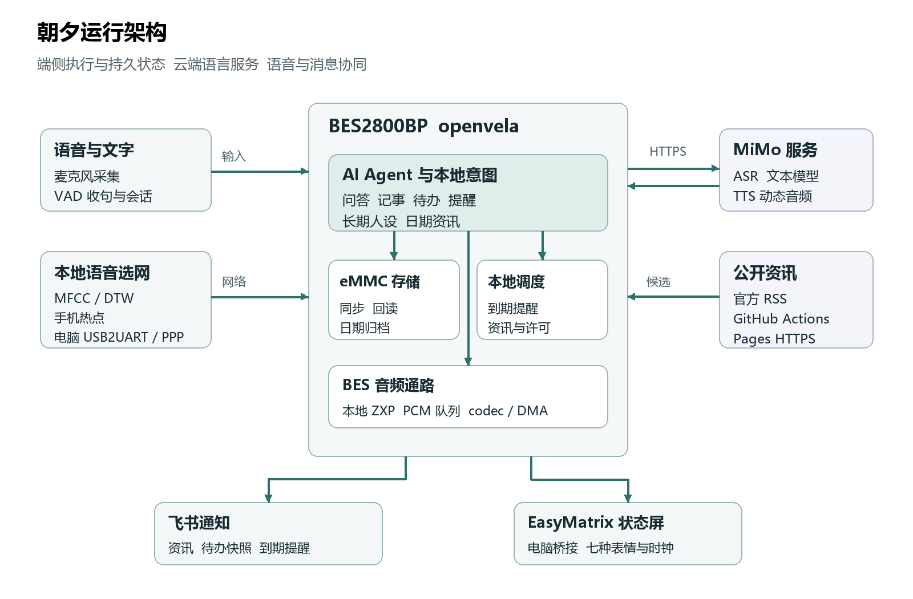

# 朝夕主动式 AI 生活管家作品介绍

电子农民工队 416　2026 首届 openvela AI 硬件全球开发者大赛

版本 2026 年 11 月 4 日

## 让随口交代的事情得到回应

学习、编程或做电子实验时，常常会临时想起一件事：明天带学生证、稍后取快递、记下一个待办，或者弄清一个概念。朝夕把这些需求放到书桌旁，用语音接住，用本地记录和任务调度继续处理。

朝夕基于 BES2800BP、openvela 与 MiMo 构建。它能够问答、记事、管理待办和定时提醒，也能保存个人兴趣、整理每日资讯，并通过飞书发送需要回看的内容。使用者说出需求，设备把理解、执行、保存与播报连起来。

## 围绕日常活动组织功能

### 有问题就问

说“你好，夕夕”，听到回应后提出问题。板载麦克风采集声音，MiMo 完成语音识别与语言理解，BES 再把生成的答案通过喇叭播报。回答结束后，可以在同一会话中继续交流。

### 想到事情就记

“帮我记一下，明天带学生证”会成为当天的备忘。记录按北京时间归档，保存到 eMMC；查询时读取实际文件。待办则取得固定编号，可以添加、查看并完成指定条目，便于管理几件同时进行的事情。

### 约好的事情按时提醒

“三十秒后提醒我喝水”会转为板端调度任务。任务保存后回读编号与到期时间，时间到达后主动播报。喝水提醒支持单独开启、查询和关闭，将临时需求延伸为日常节奏。

### 资讯跟随自己的兴趣

朝夕保存使用者明确设置的长期人设，用它筛选公开资讯并整理中文摘要。资讯包含日期、标题、来源与链接，今天和昨天各自归档。早晨准备好内容后，先询问是否播放；也可以直接说“播放今天的新闻”或“播放昨天的新闻”。

“记住，我最近在学习嵌入式”可以更新长期人设。设备先复述候选内容，收到明确确认后再写入，使兴趣变化成为之后个性化服务的依据。

### 语音交代 飞书回看

设备可以把新闻、待办快照和到期提醒发送到固定飞书目标。板端负责鉴权、消息入队和服务回执，正在进行的问答优先使用音频与网络资源。用户离开书桌后，可以在熟悉的消息入口继续查看事项。

## 开机时自己选择联网方式

接通电源后，朝夕本地播放“选择有线连接还是无线连接”。使用者说“无线连接”，设备连接已保存的手机热点；说“有线连接”，设备通过 USB2UART 与电脑待命程序建立 PPP。

两条口令采用 MFCC 语音特征与 DTW 模板匹配，在联网前完成识别。选择、成功和失败提示由本地 ZXP 音频播放。联网、校时与连通性检查完成后，进入正常语音服务。

这种设计让网络选择本身也成为语音体验的一部分。手机热点适合独立摆放，电脑 PPP 便于开发和演示，两条路径使用同一套 Agent、存储与任务能力。

## 一句话如何成为记录与任务

板端承担音频、意图路由、工具调用、存储和调度。明确的记事、待办与相对提醒直接进入本地 C 模块；自由问题交给 Agent 与 MiMo。执行结果沿消息通道送往语音或文字输出，记录可通过查询回读。

| 技术层 | 实现要点 | 产品作用 |
| --- | --- | --- |
| 设备与系统 | BES2800BP、openvela／NuttX、官方 ai_agent | 在设备端组织消息、工具、记忆、Skill 与任务 |
| 语音 | 麦克风、MiMo ASR／TTS、codec 与 HAL DMA | 把自然表达接到可听见的回答 |
| 本地执行 | 意图快捷路由、固定待办编号、提醒读回 | 常用事项快速落到具体记录和任务 |
| 长期保存 | eMMC、文件同步、回读和原子替换 | 备忘、人设、配置与任务跨会话延续 |
| 资讯服务 | RSS、GitHub Actions、Pages HTTPS、日期缓存 | 公开候选持续更新，板端结合人设整理 |
| 消息与状态 | 飞书队列和回执、EasyMatrix 状态桥 | 事项可回看，设备进度可感知 |

## 为连续使用做的工程设计

固定提示语在本地预先生成并校验，唤醒回应和选网提示可以直接播放。动态回答根据网络路径选择播放策略：无线边接收边播放，PPP 先完整预取并校验，再连续输出。24kHz、单声道、16 位 PCM 由板端 DMA 播放，网络接收与音频消费各有清晰的缓冲边界。

持久化操作把“写入”和“确认”连接起来。备忘追加后同步与回读，待办按稳定编号修改，提醒按照创建返回的编号检查。人设更新经过口头确认、备份和原子替换；公开资讯与用户记忆分开存放。

电脑接入使用独立的串口所有权和会话生命周期。Windows 待命程序识别有线接入请求，建立 WSL PPP 网关；退出时回收板端会话、串口、接收线程和临时转发规则。显示桥通过另一条 USB 串口同步像素钟状态，租约结束后回到时钟页面。

## 看得见的实现成果

本地备忘与待办的实板样本约 0.34～0.40 秒完成，包含保存或修改与结果核对。语音连续播放样本中，18.88 秒内容实际播放 18.923 秒，最大音频块间隔 1 毫秒。11 月 4 日两轮有线运行还完成了 PPP、校时、TTS、正常退出与重新连接。

项目同时维护业务、语音、网络、模板识别和消息通知的代码回归。11 月 4 日阶段包含 88 项 headless Python 与 110 项电脑工具检查，实际 C 模块配合内存检查和失败注入，持续核对文件、音频和资源释放。

## 与 9 月 20 日版本相比

9 月 20 日，朝夕以 454×454 圆屏、触摸键盘、Skill 和 cron 建立了生活管家的原型。当前版本把主要交互转为语音，并将原来的主动服务思路推进到持久记录、按兴趣整理的资讯、网络选择和消息联动。

| 演进方面 | 9 月 20 日 | 当前版本 |
| --- | --- | --- |
| 使用入口 | 圆屏 UI、触摸键盘、页面导航 | 语音唤醒与对话，本地开机选网，配合像素表情 |
| 记录与任务 | Skill、约定文件与 cron 驱动 | 本地 C 快捷执行与 Agent 协同，固定编号与读回 |
| 数据保存 | LittleFS 挂载与 tmpfs 回退设计 | eMMC 持久化，按日期保存备忘和资讯，人设确认后更新 |
| 主动服务 | 每日简报、健康提醒与屏幕呈现 | 按兴趣准备资讯、询问后播放、周期喝水与语音提醒 |
| 联网与消息 | 配置 Wi-Fi、云端模型、界面状态文件 | 手机热点与电脑 PPP 双路径，飞书同步资讯和事项 |

更完整的功能变化和历史来源见 [版本演进](版本演进20260920至20261104.md)。

## 面向书桌的产品形态

朝夕以语音为主要交互，用户可以保持手头的学习和制作活动。问答解决眼前疑问，备忘保存临时念头，待办与提醒把事情延伸到之后，资讯和飞书让服务贯穿一天中的不同时间与位置。

可选 EasyMatrix 像素屏以七种颜文字显示状态，让聆听、思考和播报有直观反馈。作品将端侧执行、云端语言服务和日常消息入口组合成一台桌面生活管家。

## 资料与工程入口

技术实现见 [技术报告](technical_report.md)，运行方法见 [核心功能说明](无屏核心功能.md) 与 [开机选网](开机语音选网.md)。源码、固件、构建和工程记录的入口集中在 [项目导览](项目完整交接.md)。
