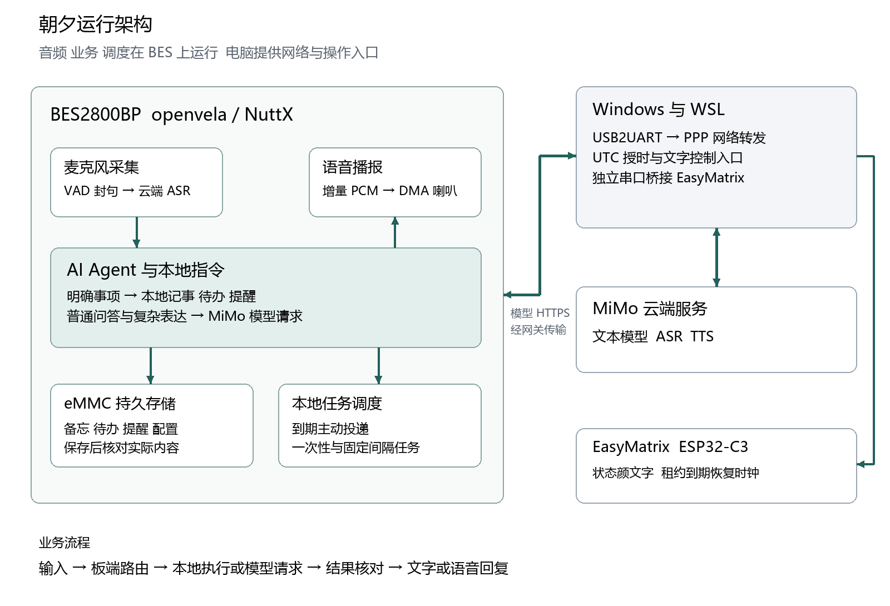

# 朝夕主动式 AI 生活管家技术报告

2026 首届 openvela AI 硬件全球开发者大赛　电子农民工队 416

报告日期 2026 年 11 月 4 日　语音与主动服务版本

## 1 信息表

| 项目 | 内容 |
| --- | --- |
| 作品名称 | 朝夕主动式 AI 生活管家 |
| 团队 | 电子农民工队 416 |
| 方向 | AI 硬件产品创新 |
| 硬件与系统 | BES2800BP、openvela／NuttX、板载数字麦克风、两线喇叭、eMMC；可选 EasyMatrix 状态屏 |
| AI 服务 | MiMo 文本模型、语音识别与语音合成 |
| 源码 | open-vela/contest2026_416_dianzinongmingong，dev-ai-contest-2026 分支 |

团队由板级调试、产品应用、系统集成与实物演示协同推进。开发过程使用 Codex、OpenCode 等 AI 工具完成调查、实现、回归与资料整理，成员负责需求判断、方案取舍和现场体验确认。

## 2 摘要

朝夕面向学习、编程和电子制作的桌面场景，将语音问答、备忘待办、定时提醒、长期人设、兴趣资讯和飞书通知整合为设备端生活管家。BES2800BP 运行 openvela 与 ai_agent，承担采集、路由、工具、存储、调度和播放；MiMo 提供语言与语音服务，手机热点或电脑 PPP 提供联网出口。

系统围绕真实使用过程做了几项设计：开机以个人 MFCC／DTW 模板识别联网选择，固定提示语本地播放；明确事项走本地 C 执行，结果保存并回读；资讯按人设筛选、按日期缓存，征得许可后播报；有线音频完整预取，无线增量播放；飞书通过板端队列与服务回执承接事项。产品把一次对话延伸为可保存、可查询和按时间主动执行的任务。

## 3 技术实现

### 3.1 场景与产品方案

书桌活动具有连续性：用户可能正在写代码、搭电路或阅读资料，希望在不中断手头动作的情况下交代事情。朝夕以语音为主要入口，问答解决眼前问题，备忘留下临时想法，待办和提醒管理后续动作。资讯和飞书进一步连接早晨获取信息与离桌回看。

系统建立在官方 ai_agent 的消息总线、Agent 循环、工具、Skill、记忆与调度之上。明确的高频指令由产品模块快速执行，开放表达交给模型与工具。设备端业务、云端语言能力和持久记录共享同一套任务语义。

### 3.2 系统结构与职责

| 层次 | 主要组件 | 职责 |
| --- | --- | --- |
| 输入与交互 | 麦克风、VAD、选网模板、ASR 唤醒 gate | 采集语句、识别开机短指令、组织对话窗口 |
| Agent 与执行 | ai_agent、local_intent、Skill 与工具 | 意图路由、自由问答和业务执行 |
| 持久状态 | journal、todo_store、morning_store、cron | 保存备忘、待办、人设、日期资讯和任务 |
| 网络 | Wi-Fi、SNTP、PPP、TLS／HTTP、Windows watcher | 建立出口、校时、传输与连接生命周期 |
| 输出与协同 | 本地 ZXP、MiMo TTS、PCM／DMA、飞书、EasyMatrix | 播放、主动通知和运行状态反馈 |

设备通过 Wi-Fi 连接保存的手机热点，也可经 USB2UART 使用 Windows 与 WSL PPP 网关。两条网络路径汇入同一套 DNS、TCP、TLS 和云端请求。电脑有线入口提供控制与调试能力，像素钟经另一条 USB 串口接收状态。

### 3.3 开机本地识别与联网

开机先播放本地询问，再采集“有线连接”或“无线连接”。系统为每类建立三个个人样本，提取 13 维 MFCC 特征，以带约束的 DTW 比较时序距离，并结合校准与拒识规则选择结果。模板保存格式包含版本、长度、有限数值和 CRC 校验。

个人模板使两个短口令可在联网之前处理。有效选择进入对应连接流程，未知语句或静音继续等待。连接成功后校时并验证外网往返，本地播报结果，再启动正常语音服务。选网与提示的实现集中在 `uplink_keywords`、`uplink_voice`、`uplink_flow` 与 `uplink_boot`。

有线选择由 Windows boot watcher 识别标记或有效的 PPP LCP 请求，释放监听句柄并交给供网子会话。待命状态同时核对新心跳、实例、端口和子进程，确保状态对应实际资源。退出按板端会话、串口、接收线程与网关的次序回收。

### 3.4 语音输入与连续播放

正常对话采用 VAD 收句、MiMo ASR、唤醒与意图处理、TTS 及播放的流程。声音检测保留预录，静音约 1.2 秒完成封句；会话窗口按空闲计时，处理与播放期间保留本轮状态，回答结束后恢复采集。用户可使用“你好，夕夕”进入会话，听到本地“你好”后表达需求。

固定提示语封装为 ZXP1 资产，记录采样格式、长度和 CRC32。设备先校验再播放，安装过程使用分块确认、临时文件和原子替换。固定语句直接使用本地音频，动态问答与新闻正文使用 MiMo TTS。

动态 TTS 解析 SSE、JSON 与 base64，输出 24kHz、单声道、16 位小端 PCM。BES codec 与 HAL DMA 承担实际播放。无线模式用有界 PCM 队列衔接接收与消费；PPP 模式先完整接收并校验一段音频，再交给播放器，预取上限为 5,760,000 字节，对应 120 秒 PCM。

这项策略来自对两种网络的实际供音分析：24kHz 单声道 16 位音频需要 48,000 字节／秒，旧有线样本约为 34～35kB／秒。采用完整预取后，网络等待集中在开播之前，播放阶段由内存供音，长回答得以连续输出。每块音频保留取消、错误和 DMA 超时检查。

### 3.5 记事待办与本地执行

明确的记事、待办、相对提醒和喝水控制由 `local_intent.c` 识别后进入相应 C 模块。命中快捷路径时省去文本模型往返，并复用 Agent 的消息历史与输出通道。自由问题和更复杂的需求继续由 Agent 与工具处理。

备忘写入 `/emmc/zhaoxi/memory/daily/YYYY-MM-DD.md`，按固定 UTC+8 计算用户日期。追加流程完成写入、同步和回读，保留已有前缀。待办写入 `TASKS.md`，用稳定编号定位目标，通过临时文件、同步和替换保存状态。

提醒按真实时间创建，检查返回的任务编号与到期时间后确认结果。调度器负责到期投递、一次性任务移除、取消与周期恢复。喝水提醒使用独立任务归属，重复开启保持同一设置，关闭只处理自己的周期任务。

设备运行时 Skill 位于 `/emmc/zhaoxi/skills/`。项目提供“智能记事本”和“智能提醒”两个业务资产，自由表达可调用文件与 cron 工具，明确的简单指令则由 C 快捷路径执行。开发侧 `.claude/skills` 另外沉淀构建、板级调试、资产编写和协作经验。

### 3.6 人设与主动资讯

长期人设保存到 `config/USER.md`，普通长期事实位于 `memory/MEMORY.md`，每日备忘和资讯分别归档。语音提出人设修改后，设备复述候选内容；收到明确确认，再同步、回读并原子替换，保留上一版备份。

资讯服务复用官方 RSS 采集器，GitHub Actions 每小时更新，并在北京时间 06:47 增加一次预采集；GitHub Pages 以 HTTPS 提供公开候选。设备下载候选，再由 MiMo 结合人设筛选和整理中文摘要。标题、链接、来源与发布时间来自原始候选，保存为按日期命名的简报。

板端完成授时后按北京时间调度：06:55 准备，07:00 起在空闲时询问，当天较晚联网可在日间补取。资讯先缓存，再询问是否播放，明确许可触发朗读；拒绝或许可窗口结束时回到等待。已出现链接参与去重，日期缓存支持今天、昨天和中断后继续播放。

### 3.7 飞书与状态显示

飞书通知使用设备运行配置中的应用身份和固定目标。板端完成鉴权与消息请求，检查 HTTP 和业务回执，以事件编号组织发送。待办快照、新闻及到期提醒进入有界队列，活动问答优先，空闲时继续发送。用户可以语音触发内容转发，在飞书回看桌面事项。

EasyMatrix 扩展使用 ESP32-C3 与 32×8 WS2812 矩阵。电脑显示桥读取助手状态，发送带编号的 JSON 命令；屏端在刷新后返回确认。七种表情对应空闲、聆听、思考、播报、成功、错误和休眠，租约结束回到时钟。表情覆盖在 RAM 中管理，原时钟配置继续保留。

### 3.8 平台缺陷定位与修复

平台层工作覆盖上游协议栈与闭源 BSP。PPP 审计定位 `AHDLC_TX_OFFLINE=5` 的发送帧计数判据：连续第七帧触发重连，判定不含时间窗。六帧编码数据按 921600 baud、8N1 换算仅约 33.98ms。电脑直连路径已改为记录最后有效接收的单调时间，结合 63 秒期限、LCP Echo 和退出清理，并用实际源码在 ASan／UBSan 下重放突发、回复时序与失联场景。[PPP 实现与对照](PPP突发流量审计.md)

DNS 审计复现并修复了 TCP 短读／短写按剩余长度推进指针，以及 UDP 截断转 TCP 前漏关旧 socket 两项问题。对照覆盖实际函数、真实域名回复回放和实板 resolver；普通 UDP 查询超时另按发送、路由、回包与解析分层定位。[DNS 修复与对照](DNS解析审计.md)

Wi-Fi PS 审计从 AP 静态库提取有初值数据节 `ff ff ff`，再反汇编 APC1 的接收端，确认 mode=255 分支读取并替换为默认 PS 配置。分析将跨核接口约定落实到字节和指令偏移，明确保留正确配置。[BSP 二进制语义分析](WiFi_PS255审计.md)

### 3.9 首次配置与日常自主运行

热点名称和凭据首次通过串口配置工具保存到设备运行配置。日常开机由本地语音选择无线，BES 随后自主连接已保存热点、执行 SNTP 校时并启动语音和主动服务；连接中断后按策略重试。手机热点提供外网，设备端承担模型请求、业务执行、存储、调度和播放。电脑 PPP 为可选网关，便于开发和演示，两种接入方式使用同一套端侧能力。实板记录覆盖重启自动连接、热点关闭后的重连、校时及 5GHz 语音问答。[配置与实板记录](联网方式配置.md)

## 4 实现与性能样本

### 4.1 实板表现

| 场景 | 已记录结果 | 技术含义 |
| --- | --- | --- |
| 本地备忘与待办 | 11 月 2 日样本约 0.34～0.40 秒 | 本地保存或修改与结果核对的完成时间 |
| 有线长回答 | 18.88 秒音频实播 18.923 秒，最大块间隔 1 毫秒 | 完整预取后连续播放的样本 |
| 11 月 4 日第一轮 TTS | 6.080 秒音频实播 6.090 秒，最大块间隔 1 毫秒 | 有线接入、校时与播放后的正常退出 |
| 11 月 4 日第二轮 TTS | 5.920 秒音频实播 5.931 秒，最大块间隔 1 毫秒 | 重新连接后再次完成播放和资源清理 |
| 持续使用 | 11 月 2 日完成十轮助手与 PPP 启停 | 每轮问答、退出、串口与网关回收形成完整流程 |

音频播放跨度从首个成功 DMA 到最后一个成功 DMA 计时，音频自身时长按 PCM 字节数和格式计算；本地业务时间包含实际存储处理。数据来源见 [核心业务记录](bringup_logs/20261102_core_acceptance.json)、[有线恢复记录](bringup_logs/20261104_wired_recovery.json) 和 [连续播放说明](对话语音连续播放.md)。

### 4.2 工程验证

11 月 4 日阶段运行了 88 项 headless Python 和 110 项电脑工具检查。实际 C 模块另外覆盖存储、选网模板、资讯、飞书、音频与取消，使用 ASan、UBSan、泄漏检测和分配失败注入检查资源边界。

SDK 以 59 项有序补丁在固定基线上回放，再与实际构建源码比较。完整构建、AP 封装与 manifest 配套管理，BES 发布地址为 `0x30190000`。EasyMatrix 应用单独管理分区、依赖锁和源码哈希。

本轮实际业务包含语音问答、备忘和固定编号待办、定时提醒、今天／昨天新闻、人设确认保存，以及固定飞书目标收取资讯和事项。工程记录同时保留每次运行对应的版本、操作与测量，方便沿同一入口复现。

## 5 与 9 月 20 日版本的功能演进

9 月 20 日版本已经形成圆屏 LVGL、触摸键盘、四个运行时 Skill、人格记忆、cron 定点调度和文件桥。当前版本继续这一产品方向，将主要交互推进到真实语音链路，并加入 eMMC 事项持久化、本地选网、个性化日期资讯和飞书协同。

| 演进方向 | 早期基础 | 当前实现 |
| --- | --- | --- |
| 交互 | 圆屏 UI、触摸与文件桥 | ASR／Agent／TTS、真实音频、会话与本地提示 |
| 执行 | Skill 与工具驱动 | C 本地路由加 Agent，保存回读与编号管理 |
| 存储 | LittleFS 与 tmpfs 回退设计 | eMMC、人设备份、每日备忘与日期资讯缓存 |
| 主动服务 | 简报和健康提醒方案 | 个性化资讯、许可播报、语音提醒与喝水控制 |
| 接入与出口 | Wi-Fi、云端模型和界面状态 | 本地语音选网、热点／PPP、飞书与像素表情 |

历史基线固定为 [`05b2ef3`](https://github.com/open-vela/contest2026_416_dianzinongmingong/tree/05b2ef3dec3e6ebe06fcf245d94bfb02af9e51e4)，逐项来源见 [版本演进](版本演进20260920至20261104.md)。

## 6 AI 辅助开发与工程组织

项目在需求拆解、源码调查、驱动接入、音频与网络定位、回归检查和文档整理中使用 AI 工具。开发以可定位的模块为单位推进：先看源码和现象，再形成修改，随后做实际 C 检查、完整构建和板端验证，最后将过程沉淀为补丁、工具和 Skill。

成员负责产品场景、方案取舍和现场体验，主代理统筹架构、集成与验收，协作代理按模块调查、实现和独立复核。音频、网络、持久化和业务可以分别推进，通过共享接口、统一构建与实板记录汇合。

开发方法沉淀为 [六个可复用 Skill](../.claude/skills/README.md)：`openvela-dev` 管理开发闭环，`board-bringup` 管理 BES 构建与板级启动，`evidence-driven-debugging` 组织调试，`scoped-agent-dispatch` 组织协作，`device-skill-authoring` 编写设备 Skill，`cjk-font-pipeline` 管理中文字体。每项以独立 `SKILL.md` 保存适用条件、流程和工程经验。

产品运行时的智能记事本与智能提醒 Skill 则面向用户任务，复用 Agent 的文件、记忆和 cron 工具。开发侧经验与设备侧能力各有明确入口，使 AI 既参与工程迭代，也参与日常服务。

仓库保存早期 Codex／OpenCode 日志，以及 11 月 2 日至 4 日的接续归档，包含对话、工程日志、操作索引和公开结果摘要。产品源码、固定依赖、发布镜像与记录共同构成可追溯的实现资料。

## 7 产品价值与资料入口

朝夕将书桌旁的即时对话与后续事项放在同一台设备上：问答解决当前疑问，备忘和待办保存想法，调度在合适时间提醒，人设与资讯提供个性化内容，飞书把事项带到日常消息入口。端侧执行与云端语言能力共同服务这一连续过程。

9 月圆屏阶段积累的板级启动、调度、人格记忆和部署经验，在当前语音版本继续发挥作用。项目通过软件路由、真实音频与持久状态整合，形成语音交代、设备执行和消息回看的桌面生活管家。

产品化聚焦学生、开发者和电子制作用户的桌面，以语音主机、可选显示与消息服务组合形态。硬件承担音频和端侧任务，个性化内容与消息连接作为持续服务方向。问答、备忘、稍后提醒和每日资讯覆盖不同使用频率，形成连贯的日常价值。

源码入口为 `app/zhaoxi`，集成补丁见 `patches`，构建方法见 [BES 固件说明](BES固件构建与验收.md)。运行与专题资料集中在 [项目导览](项目完整交接.md)，作品场景见 [产品介绍](project_introduction.md)。

按技术难度、产品创新性、项目完整度、AI 开发、商业潜力与展示效果六项组织的评审入口，见 [作品亮点与评分对应](作品亮点与评分对应.md)。
