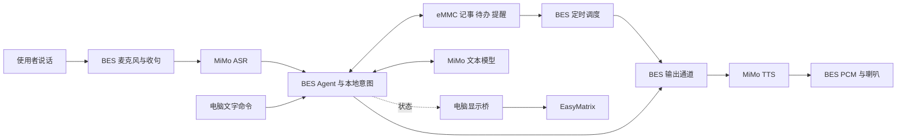

# 朝夕项目完整交接

**接续提示（2026-11-04）**：本页保留 11 月 2 日背景；最新新闻、飞书、本地选网、对话播放和有线恢复进度先读 [阶段交付](20261104有线恢复与阶段交付.md)，当前开发候选镜像及实板验证范围以该页为准。

更新：2026 年 11 月 2 日。读者可以完全不了解此前对话、比赛或硬件；按本页顺序即可知道项目为什么做、已经做到哪里、怎样运行，以及下一步由谁完成。

**当前目标：把已有的 BES 语音生活助手整理成能稳定演示、有外壳、有介绍文档和演示视频的参赛作品。** 开发板已经交给伙伴制作外壳。软件主线继续围绕问答、记事待办和定时提醒，电脑提供网络，EasyMatrix 作为可选状态屏。

## 1. 比赛和交付背景

项目参加 **2026 首届 openvela AI 硬件全球开发者大赛**，使用队伍编号 416 的专属仓库。作品采用 AI 硬件产品创新方向：在 openvela 设备上运行 AI Agent，让它实际保存事项、管理任务并主动提醒。

截至本页更新时，团队正在准备决赛材料。**11 月 4 日是用户给出的本队材料准备日期**；本队确切提交时刻、答辩场次、会议入口和 PPT 模板，由队长从决赛群核对。公开总览列出的答辩日期为 11 月 7–8 日，每队八分钟讲述、两分钟问答。材料需包括作品介绍、五分钟内的演示视频和专属仓地址。见 [官方总览](https://github.com/open-vela/docs/blob/dev-ai-contest-2026/zh-cn/contest_2026/contest_overview.md)。

[AI 硬件指引](https://github.com/open-vela/docs/blob/dev-ai-contest-2026/zh-cn/contest_2026/ai_hardware/ai_hardware_track_guide.md)强调设备运行、定制 Skill 和主动执行。本项目用智能记事本与智能提醒 Skill 展示扩展，用提醒实际到期展示主动执行。语音唤醒采用指定短语“你好，openvela / Hello，openvela”。

| 评分方面 | 分值 | 本项目准备展示的内容 |
| --- | ---: | --- |
| 技术 | 30 | 板上音频、Agent、持久存储、调度和网络接入 |
| 创新 | 20 | 书桌前口述事项、持续保存、按时提醒和表情反馈 |
| 完整度 | 20 | 保存回读、按编号修改、到期执行、正常退出与再次启动 |
| AI 开发 | 10 | 实际开发日志、可复用 Skill、具体问题的修复过程 |
| 商业场景 | 10 | 使用者、摆放位置、日常需求、实物成本 |
| 展示 | 10 | 外壳、清楚的声音、连贯任务过程和答辩表达 |

分值依据同一份官方总览；团队的拍摄和讲述安排见 [答辩与视频准备](答辩与视频准备.md)。

## 2. 作品是什么，当前范围是什么

作品名为 **“朝夕 · 无屏 AI 生活管家”**。主要场景是学习或工作时，使用者随口提问、记下一件事、设置一个提醒，设备回答、保存并在约定时间提醒。

| 核心功能 | 用户动作 | 设备完成的事 |
| --- | --- | --- |
| 问答 | 问一个简短问题 | BES 调用 MiMo，生成回答并通过喇叭播报 |
| 记事与待办 | 说“帮我记一下……”或添加待办 | 本地保存备忘；待办取得固定编号，可以查询并完成指定项 |
| 定时提醒 | 说“三十秒后提醒我……” | 保存任务，到期主动投递；支持查询和取消 |

已增加的实用扩展是周期喝水提醒、ASR 唤醒与会话窗口、EasyMatrix 表情屏，以及待账号配置的飞书固定目标接口。

原项目曾使用圆形 AMOLED 和图形界面，旧 V5 曾由用户亲自确认点亮。后来使用的圆屏持续全黑，项目因此转为无屏主线；旧 UI 和旧扩展归档在 [legacy](../legacy/README.md)。**当前不以恢复圆屏为交付前提。** 每日简报、微信入口、旧屏幕页面等未列入当前三个核心功能，保留归档供以后参考。

当前分工是本地 Agent 负责软件、固件和联调，伙伴负责实物测量、3D 外壳、装配和现场协作，用户负责总体取舍及比赛信息确认。此前尝试的独立云端编程已暂停。接手 Agent 可以继续代码与文档工作；真实收音、听感、按键和装配需要联系拿着实物的伙伴。

## 3. 硬件现状与连接关系

| 部件 | 已知情况 | 接手时怎么处理 |
| --- | --- | --- |
| BES 主机 | BES2800BP EVB V1.2，板级目录 `vendor/bes/boards/best1700_ep/aos_evb`，使用 AP 核 | 沿用当前跳帽和供电接法；现有固件已装好 |
| 麦克风 | 板载 U19、U20 数字麦克风，曾完成人声采集和识别 | 保留拾音通道，合盖后再测；已有参考原理图是 V1.3，实物为 V1.2 |
| 喇叭 | 现有 8Ω／2W 两线喇叭，沿用已经发声的 LP／LN 接法 | 连线随实物保留；2W 是喇叭额定参数，当前板端输出音量仍要现场复核 |
| 天线 | 已安装外置 2.4GHz 天线 | 留出 SMA 装卸与转动空间；当前主线经电脑供网 |
| 圆形 AMOLED | 原 454×454 屏仍全黑 | 暂放在旧硬件问题列表，壳体先围绕可用主机和音频部件设计 |
| EasyMatrix | ESP32-C3、4MB Flash、32×8 WS2812 像素钟，已装表情固件 | 保留原时钟和现有外壳，作为独立的可选状态屏 |

BES 的 **USB2UART** 是 FTDI 串口数据通道，另一根 USB 按原接法供电。原生 USB 的存在不代表插上就能共享电脑网络；当前联网程序使用 USB2UART。完全断电后，板子可能需要按住 **POWER 约 2 秒**开机；RESET 用于运行中的复位。

EasyMatrix 通过自己的 CH343 USB 串口接电脑。**两块板子各自连接电脑，由主机桥同步状态**，当前没有直接相连的 UART 电线。原电脑上 BES 为 COM3、屏为 COM4，新电脑以实际枚举为准；两种设备的 USB 标识分别为 `0403:6001` 和 `1A86:55D3`。

外壳按实物现场量尺寸，先做可拆结构，保留两根 USB、POWER、RESET、天线、麦克风声孔和喇叭出声孔。完整要求见 [外壳交接要点](外壳交接要点.md)。测尺寸和打印外壳可以直接开始，无需重刷固件。

## 4. 软件怎样工作



云端请求由 BES 发起；Windows 串口转发和 WSL PPP 网关提供互联网出口。电脑主要承担网络转发、控制入口及表情桥，业务保存与提醒调度运行在 BES 上。网络细节见 [电脑网络共享](电脑网络共享.md)。

明确的记事、待办、相对时间提醒和喝水指令走本地模块，保存并回读后返回结果，省去文本模型请求。普通问答和更自由的表达进入 Agent。所有业务句式和命令以 [无屏核心功能](无屏核心功能.md)、[本地中文指令](本地中文指令.md) 为准。

### 语音交互

默认启动时麦克风关闭。操作者主动开启后，设备按“声音检测 → 约 1.2 秒静音封句 → 云端 ASR → 匹配唤醒／处理需求 → TTS 与播放 → 恢复收音”运行。唤醒后会话空闲窗口为 60 秒，处理过程中不会因空闲倒计时提前结束。

“你好，openvela / Hello，openvela”由 ASR 识别后匹配，等待唤醒期间也使用云端识别。识别、处理和播放期间暂停收音；等回答完整结束后再说下一句。当前采用半双工交互，下一句在忙时说出不会排队。停止时检查 `enabled`、`running` 均为 `false`。详见 [交互与停止规则](语音交互收尾.md)。

TTS 通过 SSE 增量接收，解码为 24kHz、16 位、单声道 PCM，经过有界队列和约 640ms 首播缓冲，再由 DMA 播放。模型结果缓存在产品配置中关闭，每轮按当前问题处理；对话历史仍用于上下文。

### 记忆与持久数据

| 数据 | 板端位置 | 作用 |
| --- | --- | --- |
| 当天备忘 | `/emmc/zhaoxi/memory/daily/YYYY-MM-DD.md` | 按北京时间归档的实际记录 |
| 待办 | `/emmc/zhaoxi/TASKS.md` | 固定编号与完成状态 |
| 提醒 | `/emmc/zhaoxi/cron.json` | 一次性和周期任务 |
| 长期记忆 | `/emmc/zhaoxi/memory/MEMORY.md` | Agent 可读取的长期内容 |
| 运行配置 | `/emmc/zhaoxi/config/config.json` | 服务与联网设置，含私密凭据 |

系统还使用近期记忆和会话历史组织回答。当前“记忆”由文件、历史上下文和确定性业务存储组成；新增备忘会真实写入每日文件。维护逻辑见 [本地记事](本地记事.md) 和 [业务资产](../assets/agent_deploy/README.md)。更新资产时保留已有 MEMORY、cron、待办和每日文件。

每次正式启动使用电脑 UTC 授时，提醒保存 UTC 时间，用户日期按北京时间显示。完全断电后先恢复正确时间，再检查到期任务。

## 5. 当前版本、检查结果和剩余工作

| 部件 | 发布文件 | 大小与 SHA256 | 写入地址 |
| --- | --- | --- | --- |
| BES AP | [BIN 与 manifest](../firmware/headless_pc_link/nuttx_ap_headless.manifest.json) | 1,355,720 字节；`8aa769552f24f0caffcc6822b30d0b30f3674c7642117f4b1ef8c7e7022f2f49` | `0x30190000` |
| EasyMatrix 应用 | [BIN 与 manifest](../firmware/easymatrix/EasyMatrix.ino.manifest.json) | 1,194,544 字节；`6f8fd7b2335664e55538f56e0a1e32bfcde8f574922259607ec628732d8da5ba` | `0x10000` |

现有两块设备均完成对应镜像写入。BES 的完整构建、49 项 SDK 补丁回放和 28 个目标文件一致性已核对；37 项文字入口实板业务、10 次完整会话启停通过。主机工具 87 项、显示桥 53 项回归通过。屏端完成应用读回、七种表情确认、帧更新、租约恢复及原 23 项设置保留检查。

这些结果、语音逻辑的合成输入检查和性能样本汇总在 [公开验收 JSON](bringup_logs/20261102_core_acceptance.json)。10 次启停是助手／供网会话的启动、问答和退出。最终版真人说话、音量与播放连续性由在场伙伴继续确认。原录音和播放链路此前已有用户听感反馈，最终版验收按 [三分钟现场流程](三项核心功能实板验收.md) 执行。

| 顺序 | 剩余任务 | 完成后应得到什么 | 主要协作方 |
| --- | --- | --- | --- |
| 1 | 确认演示电脑和供网环境 | 预检通过、`PPP_UPLINK_READY`、时间正确、文字问答可用 | 软件 Agent + 实物伙伴 |
| 2 | 最终真人语音验收 | 唤醒、问答、记事、30 秒提醒、停止监听；记录听感与说完到首声时间 | 在场伙伴 + 软件 Agent |
| 3 | 外壳与装配 | 可拆壳体、接口和声孔可用，合盖后收音／播放正常 | 3D 打印伙伴 |
| 4 | 表情屏目视确认 | 表情清楚、方向与亮度合适、退出恢复时钟 | 在场伙伴 |
| 5 | 录制和材料收尾 | 最终照片、五分钟内视频、介绍文档、答辩 PPT、成本与分工 | 团队 |
| 6 | 审核既有 AI 日志 | 用户确定公开范围后处理 | 用户 |
| 后续 | 飞书实发、独立 Wi-Fi、圆屏恢复 | 分别配置账号验证发送、继续无线联调、继续硬件排查 | 按后续安排 |

最终版 15 次文字模型请求的模型阶段中位数为 2.139 秒，范围 1.754～3.830 秒；完整语音等待还含收句、ASR 和首声播放。历史曾出现长等待，继续调优时按阶段记录，详细分析留在 [语音响应优化](语音响应优化.md)。

## 6. 直接运行已有板子

### 第一次在新电脑上使用

先准备 Windows、Python 3、FTDI 驱动和 Ubuntu-22.04 WSL；WSL 需要 Python 3、`pppd`、`ip`、`iptables`、PPP／TUN 设备和 root 网络转发权限，电脑应能正常上网。在仓库根目录运行：

```powershell
python -m pip install pyserial==3.5
python tools/pc_link/launch.py --check-only
```

接好原供电线与 USB2UART。完全断电后如未启动，按 POWER 约 2 秒；端口按实际设备修改。第一个窗口执行并保留：

```powershell
python tools/pc_link/launch.py --port COM3
```

看到 `PPP_UPLINK_READY` 后，在第二个窗口读取时间与状态，再发一次问答：

```powershell
python tools/pc_link/control.py --time
python tools/pc_link/control.py --auto-status
python tools/pc_link/control.py --cmd ask 用一句话介绍自己
```

麦克风默认保持关闭。文字命令的接收回执与实际业务结果分开查看；备忘、待办、提醒分别用 `--notes`、`--tasks`、`--reminders` 直接回读。完整环境、每次会话默认一小时时长、语音启动与故障恢复入口见 [Windows 操作说明](../tools/pc_link/README_zh-cn.md)。

### 在场时体验自动语音

在供网窗口继续运行的条件下，操作者准备好再执行：

```powershell
python tools/pc_link/control.py --cmd auto wake on
python tools/pc_link/control.py --cmd auto start
```

等待校准完成，靠近板载麦克风约 5～10 厘米，说“你好，openvela，一加一等于几”，等回答播完再继续。现场完整测试采用 [实板验收流程](三项核心功能实板验收.md)，按返回的真实待办和提醒编号操作。

结束先停止监听并核对，再结束供网：

```powershell
python tools/pc_link/control.py --cmd auto stop
python tools/pc_link/control.py --auto-status
python tools/pc_link/launch.py --stop
```

等正常退出提示后关闭窗口。已在运行的会话统一通过 `control.py` 操作，避免再打开串口终端。

### 可选像素屏

屏幕单独接电脑，新窗口运行 `python tools/display_link.py`，即可跟随当前助手会话；单独看表情可用 `python tools/display_link.py --port COM4 --show listening`。冷启动可能先等待配网和对时，主机桥会等待协议就绪；操作和恢复时钟说明见 [颜文字屏使用](颜文字屏使用.md)。

## 7. 重新开发或构建时从哪里开始

正式交付仓库为 [open-vela/contest2026_416_dianzinongmingong](https://github.com/open-vela/contest2026_416_dianzinongmingong/tree/dev-ai-contest-2026)，分支是 `dev-ai-contest-2026`；[PR #12](https://github.com/open-vela/contest2026_416_dianzinongmingong/pull/12) 保存本次集成过程。后续开发从正式分支开新分支，再按 [比赛提交指南](https://github.com/open-vela/docs/blob/dev-ai-contest-2026/zh-cn/contest_2026/code_submission_guide.md) 提交和合入。

```bash
git clone --branch dev-ai-contest-2026 https://github.com/open-vela/contest2026_416_dianzinongmingong.git
```

| 目录 | 要修改的内容 |
| --- | --- |
| [app/zhaoxi](../app/zhaoxi/README.md) | 产品入口、本地意图、记事、待办、提醒、喝水、MiMo、BES 音频和电脑控制 |
| [patches](../patches/README.md) | 对 AI Agent、apps、NuttX 与 BES vendor 的集成改动 |
| [configs](../configs/bes_headless.sources.json) | 固定源码、BSP 库身份、完整 defconfig |
| [assets/agent_deploy](../assets/agent_deploy/README.md) | 人格、用户配置、初始记忆和两个业务 Skill 模板 |
| [tools/pc_link](../tools/pc_link/README_zh-cn.md) | Windows 启动、停止、串口转发、控制和 WSL 网关 |
| [extension/EasyMatrix](../extension/EasyMatrix/README_zh-cn.md) | 像素钟扩展源码、固定依赖、协议和应用分区 |
| [tests/headless](../tests/headless/) 与 [tests/display](../tests/display/) | 业务、SDK、网络、语音和显示回归入口 |
| [firmware/headless_pc_link](../firmware/headless_pc_link/) | 当前 BES 发布镜像与清单；`firmware/headless` 是历史版本 |
| [docs/submission](submission/README.md) | 作品介绍 Word／PDF 与架构 SVG／PNG |
| [logs](../logs/README.md) | 既有 AI 开发材料，按用户审核安排维护 |

本仓库是产品工程，不包含完整 openvela 源码和所有 BSP 依赖。重新编译 BES 要准备完整 Linux／WSL 工作区、匹配库和构建工具，按 [BES 构建与验收](BES固件构建与验收.md) 的顺序集成。当前产品配置是 `apheadless`，库配置是 `apaudio3`；固定版本和哈希以 [sources.json](../configs/bes_headless.sources.json) 为准。本地 vendor 提交和 BSP 库需按清单单独准备。

**已有板子运行、重新编译、重新烧录是三件不同的事。** 只做外壳或现场体验，先用现有安装。代码有改动时，重建固件并配对更新 manifest；修改 SDK 后，重新回放补丁并比较实际构建源码。AP 使用厂商双芯片下载工具写到 `0x30190000`，沿用现有引导和 APC1。像素屏只更新 `0x10000` 的应用，保留原分区、配置和时钟数据。

EasyMatrix 的 Arduino core、库、板型和分区已固定，复现按 [扩展源码说明](../extension/EasyMatrix/README_zh-cn.md)。此前云端做过最小工具链编译，当前本地已完成真实工程构建；新环境仍要准备工程本身的依赖。

## 8. 常见问题与处理顺序

| 现象 | 先判断哪一层 | 推荐处理 |
| --- | --- | --- |
| 看不到串口 | 电脑 USB／驱动 | 核对 USB2UART 数据线、FTDI 驱动和实际端口 |
| 能打开 COM，但板子无输出 | 板端是否开机 | 保持供电，按 POWER 开机；运行中恢复使用 RESET |
| COM 拒绝打开或写超时 | 电脑串口占用／FTDI 状态 | 正常结束已有会话与其他串口程序，仍异常时重插 USB2UART；RESET 只重启主控，不能重枚举电脑端 FTDI |
| Wi-Fi 可扫描但云端不通 | 原生无线及网络出口 | 交付先用电脑 PPP，按 DNS、TCP、TLS、HTTP 分层分析；避免为赶演示反复切换主方案 |
| 收到命令回执却没有听见回答 | 处理阶段或播放 | 读状态、核对本轮错误和任务结果，再检查音频；命令被接收后业务仍可能在进行 |
| 停顿后说第二句话没回应 | 当前是否识别／处理／播放 | 等上一句播完再说；空闲超过 60 秒时重新加唤醒短语 |
| 提醒日期不对 | 授时 | 使用正式入口重新校准 UTC，再读取时间和任务 |
| 表情串口存在却不响应 | 屏端主循环和协议 | 等冷启动完成，确认 CH343 与 `zhaoxi.display` 固件，使用桥接程序握手 |
| 听感小或合盖后识别差 | 声音通道和实际音量 | 保留现有接法，先开盖对照，确认声孔与朝向，再调整参数 |

定位时先记录实际版本、复现步骤和出错阶段，再改对应模块。详细失败与恢复检查留在各专题文档，夜间修复历史见 [11 月 2 日工作记录](20261102夜间工作交接.md)。

## 9. 比赛材料、配置和日志的交接

已经准备 [六页作品介绍及架构图](submission/README.md)、[视频与答辩流程](答辩与视频准备.md)、[交付清单](交付核对清单.md) 和 [现场验收流程](三项核心功能实板验收.md)。团队继续补最终外壳与接口照片、实际成本、成员分工、演示视频和答辩 PPT；视频用真实任务展示保存、执行与提醒，画面交代电脑供网。

服务密钥、热点密码和实际用户记录保存在板子或操作者本机。新电脑运行现有板子可沿用板端配置；公开仓库的资产是干净模板。需要重新配置账号时由用户提供私下文件，交接文档和 Git 提交只记录配置方法。

截至本页更新，`logs/` 有 **39 个受版本控制的文件，其中 34 份 `.jsonl` 对话记录**，本次继续保留原样，由用户审核公开范围。新增原始语音、串口数据和整片 Flash 备份留在私密工作目录；公开材料使用整理后的业务与版本结果。

`tools/prepare_delivery_bundle.py` 可生成带 `BUNDLE.json`、`SHA256SUMS` 和 `verify_bundle.py` 的交付包，包含发布固件、运行工具和本交接资料。复制包用于现场运行；完整源码和历史在 Git 仓库中。文件校验完成后再做新电脑预检。

## 10. 给下一位 Agent 的开始指令

> 你接手的是队伍 416 的“朝夕”openvela／BES2800BP 生活助手。先读本文件、README、当前两份固件 manifest 和公开验收 JSON，再核对工作区与远端分支。实物已交伙伴做外壳，当前稳定主方案是电脑 USB2UART／WSL PPP 供网。围绕问答、记事待办、定时提醒完成现场验收和比赛材料；先复用现有固件。明确区分文字实板结果、代码回归和真人听感，按待办推进。不要自行开启麦克风；有在场操作者再安排说话与播放。保留设备已有业务数据和用户尚未审阅的 AI 日志。向用户报告当前做到哪一步、剩什么条件、下一步要验证什么。开发改动提交后核对源码、固件、manifest 和使用文档，再按正常 PR 流程合入。

### 建议使用的技能

根据任务读取仓库 [.claude/skills](../.claude/skills/README.md) 中的 `openvela-dev`、`board-bringup`、`evidence-driven-debugging` 或 `device-skill-authoring`。文档工作可使用接手环境提供的 `oil-tone`、`documents`、`pdf`、`presentations`；跨 Agent 交接可使用 `handoff`。技能是否可用以实际环境为准，先读取对应 `SKILL.md` 再执行。

优先阅读：本页 → [当前验收状态](三项核心功能实板验收.md) → [交付清单](交付核对清单.md) → [比赛材料](答辩与视频准备.md)。需要改代码时再进入 [构建与验收](BES固件构建与验收.md) 和对应源码。
